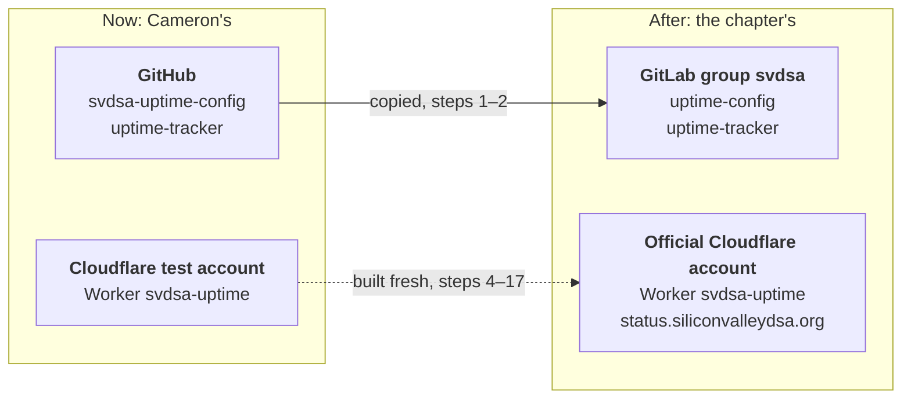
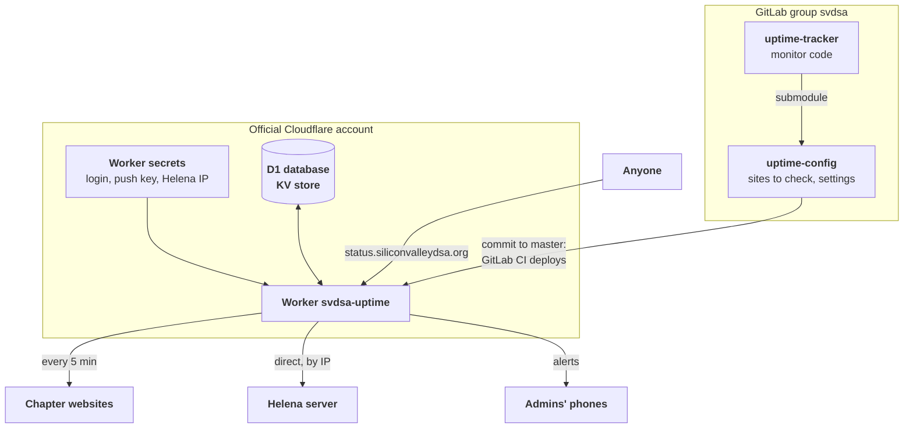

# SVDSA uptime monitor: setup

_For the SVDSA tech committee._

**Follow along on the [checklist page](https://cinderblock.github.io/svdsa-uptime-config/)**, where the boxes tick and your browser remembers them. There's also a [printable PDF](https://cinderblock.github.io/svdsa-uptime-config/setup.pdf).

This moves the chapter's uptime monitor from Cameron's accounts to the chapter's. Do the steps in order. It takes about an hour.

## What's moving



Past check results aren't copied; the new monitor starts empty. Cameron's copy keeps running as a backup.

## How it fits together



Both repos are public: they hold only domain names, Cloudflare IDs, and the public push key. Passwords, private keys, and Helena's IP go in Worker secrets and VaultWarden.

**You need:** Owner on the `svdsa` GitLab group with an SSH key on your GitLab account, admin on the official Cloudflare account, VaultWarden, Git, and Bun.

## GitLab

### 1. Import `uptime-config`

[New project](https://gitlab.com/projects/new) → **Import project** → **Repository by URL**:

* **Git repository URL:** `https://github.com/cinderblock/svdsa-uptime-config.git`
* **Project URL:** group `svdsa`, slug `uptime-config`
* **Visibility:** Public

- [ ] `svdsa/uptime-config` shows files

### 2. Fill in `uptime-tracker`

`svdsa/uptime-tracker` already exists, empty. Push the monitor code into it:

```sh
git clone https://github.com/cinderblock/uptime-tracker.git
cd uptime-tracker
git push git@gitlab.com:svdsa/uptime-tracker.git master
```

Then in that project: **Settings → General → Visibility** → **Public** → **Save changes**.

- [ ] Both projects show files in a logged-out browser window

### 3. Optional: let Cameron push fixes

Add `@cinderblock` as **Maintainer** in [`uptime-tracker` members](https://gitlab.com/svdsa/uptime-tracker/-/project_members). Nothing deploys from there on its own.

- [ ] Added, or skipped

## Cloudflare

In the [dashboard](https://dash.cloudflare.com), select the official SVDSA account.

### 4. Check the Workers plan

**Workers & Pages → Plans.** Either works:

* **Free:** 100k requests a day. A flood stops every Worker on the account until 5 PM PDT / 4 PM PST (00:00 UTC).
* **Paid ($5/month):** keeps running and bills the flood, about $24 for a full day at 1,000 requests a second. Add **Notifications → Add → Budget Alert**. It emails; it doesn't cap spending.

- [ ] Plan checked, and budget alert added if Paid

### 5. Check the `workers.dev` subdomain

Under **Workers & Pages**, **Your subdomain** must be set. If it isn't, pick a name the chapter can keep. A new one can show error 1042 for a few minutes.

- [ ] Subdomain set

### 6. Create the database and KV store

* **Storage & databases → D1 SQL database → Create Database.** Name it exactly `svdsa-uptime`. Note its **Database ID**.
* **Storage & databases → Workers KV → Create instance.** Name it `svdsa-uptime`. Note its **ID**.

Don't create tables; the deploy does.

- [ ] Database ID noted
- [ ] KV ID noted

### 7. Create the deploy token

**Manage Account → Account API Tokens → Create Token → Create Custom Token**, not the "Edit Cloudflare Workers" template:

* **Name:** `gitlab uptime-config deploy`
* **Permissions**, Account, Edit: **Workers Scripts**, **D1**, and **Workers KV Storage**
* **Account Resources:** the official SVDSA account only

**Continue to summary → Create Token**, and copy it; it's shown once.

- [ ] Token copied

## Deploy

### 8. Add the GitLab CI variables

In [`uptime-config` CI/CD settings](https://gitlab.com/svdsa/uptime-config/-/settings/ci_cd) → **Variables**:

* `CLOUDFLARE_API_TOKEN`: the token. **Masked and hidden**, **Protected**.
* `CLOUDFLARE_ACCOUNT_ID`: in Cloudflare, press **Ctrl+K** (**Cmd+K** on Mac) and run `Copy account ID`. **Protected**.

- [ ] Both added

### 9. Make the push keys

```sh
bunx web-push generate-vapid-keys
```

Keep the **Public Key** for step 10. Save the **Private Key** in VaultWarden as `VAPID_PRIVATE_KEY`.

- [ ] Keys made, Private Key in VaultWarden

### 10. Fill in `wrangler.toml`

In `svdsa/uptime-config`, open `wrangler.toml` with **Edit → Web IDE**, fill in the three empty values, and commit directly to `master`, not a new branch. That starts the first deploy.

```toml
VAPID_PUBLIC_KEY = ""   # Public Key, step 9

[[d1_databases]]
database_id = ""        # Database ID, step 6

[[kv_namespaces]]
id = ""                 # KV ID, step 6
```

- [ ] Committed

### 11. Watch the deploy

In `svdsa/uptime-config`, open **Build → Pipelines**. If GitLab asks for **identity verification**, do it and retry the job. Then, in Cloudflare, open the `workers.dev` address under **Workers & Pages → svdsa-uptime**. Results appear within 5 minutes.

- [ ] Pipeline passed
- [ ] Status page shows results

## Secrets

Secrets go in **Workers & Pages → svdsa-uptime → Settings → Variables and Secrets → Add**, **Type: Secret**. Add a step's secrets, then click **Deploy**. Later GitLab deploys keep them.

### 12. Add the login and push key

* `DASHBOARD_PASSWORD`: an admin passphrase. Save it in VaultWarden.
* `AUTH_SECRET`: a long random string, such as from `openssl rand -base64 48`.
* `VAPID_PRIVATE_KEY`: from step 9.

Add all three before **Deploy**: a password without `AUTH_SECRET` breaks the page.

- [ ] Deployed, passphrase in VaultWarden

### 13. Add the Helena checks

Three checks at Helena's real IP show whether the web server, HTTPS, or the whole server is down. The page never shows the IP. Find it in the `siliconvalleydsa.org` `A` record under **DNS → Records**.

Add this as `SECRET_SERVICES`, with `HELENA_IP` replaced three times, and save a copy in VaultWarden:

```json
[
  {
    "id": "helena",
    "name": "Helena (origin, direct)",
    "panel": "Silicon Valley DSA",
    "address": "HELENA_IP",
    "kind": "http",
    "host": "siliconvalleydsa.org",
    "redirect": "https://siliconvalleydsa.org/"
  },
  {
    "id": "helena-https",
    "name": "Helena (HTTPS port)",
    "panel": "Silicon Valley DSA",
    "address": "HELENA_IP",
    "kind": "tcp",
    "port": 443
  },
  {
    "id": "helena-ssh",
    "name": "Helena (SSH port, is the VPS up?)",
    "panel": "Silicon Valley DSA",
    "address": "HELENA_IP",
    "kind": "tcp",
    "port": 22
  }
]
```

- [ ] Deployed, copy in VaultWarden

## Go live

### 14. Connect `status.siliconvalleydsa.org`

1. Under `siliconvalleydsa.org` → **DNS → Records**, check nothing is named `status`. If something is, find out what uses it before removing it.
2. **Workers & Pages → svdsa-uptime → Settings → Domains & Routes → Add → Custom Domain**: `status.siliconvalleydsa.org`. It takes a few minutes.

- [ ] [status.siliconvalleydsa.org](https://status.siliconvalleydsa.org) loads

### 15. Check it on the new address

On [status.siliconvalleydsa.org](https://status.siliconvalleydsa.org), not `workers.dev`; alerts belong to the address you sign up on.

1. The three Helena rows show **DIRECT** and up. Allow up to 5 minutes.
2. **Admin** → log in.
3. On your phone, tap a 🔔 bell and allow notifications. On iPhone, add the page to your Home Screen first and open it from there.
4. Your phone shows on [/subscriptions](https://status.siliconvalleydsa.org/subscriptions).

> If the Helena rows show down while the site is up, Helena's firewall may only allow Cloudflare's proxy. Tell Cameron.

- [ ] Helena rows show **DIRECT**
- [ ] Login works
- [ ] Phone listed

### 16. Turn off `workers.dev`

In `wrangler.toml`, add this right below `upload_source_maps = true`, and commit to `master`:

```toml
workers_dev = false
```

- [ ] Pipeline passed, and the `workers.dev` address no longer loads

### 17. Suggested: add a flood rule

This blocks floods before they reach the Worker, so they aren't billed. Free zones allow one rate-limiting rule and can't target one hostname, so it also covers the main site's homepage. Skip it if `siliconvalleydsa.org` already has one.

1. `siliconvalleydsa.org` → **Security → Security rules → Create rule → Rate limiting rules**. Name: `Status page flood guard`.
2. **Edit expression:** `(http.request.uri.path eq "/") or (http.request.uri.path eq "/api/poll")`
3. 20 requests per 10 seconds, per IP. Block for 10 seconds. **Deploy**.

- [ ] Deployed and both sites still load, or skipped

## Afterwards

* **Change the checked sites:** edit `src/config.ts` and commit to `master`.
* **Change the Helena checks:** update `SECRET_SERVICES` in Cloudflare (then **Deploy**) and in VaultWarden.
* **Replace the token:** redo step 7, update `CLOUDFLARE_API_TOKEN` in GitLab, and delete the old token.
* **Update the monitor code:** move the `vendor/uptime-tracker` submodule forward and commit.

A failed pipeline leaves the last good deploy running.
